# Administrator

The **Administrator** (German role label *Administrator/-in*) is the superset role in LibreClinicaMUW. It combines the two responsibilities other chapters split between dedicated roles: **system setup** (user accounts, locations, uploader tokens, modality catalog, password policy, scheduled jobs, system status) and **study setup** (creating studies and their sites, building event definitions and CRFs, rules, datasets, importing data). Wherever the application gates a screen on *Administrator*, you reach it; several of those screens are visible to no other role.

This chapter is the operational reference for the Administrator's day-to-day surfaces in the Vue web application. For role-specific data-entry and review workflows, see the companion chapters:

- [role-data-manager.md](role-data-manager.md) — study build, rules, datasets, import (the Administrator shares these surfaces with the Data Manager / *Studienleitung*).
- [role-investigator.md](role-investigator.md) — subject enrolment, event scheduling, CRF data entry.
- [role-monitor.md](role-monitor.md) — source-data verification, notes & queries, audit review.

> **Note on role gating.** The web app hides controls you are not allowed to use, but the *server* is the authoritative gate — every Administrator-only action is re-checked on the backend and every lifecycle action (disable, restore, reset, status change) is written to the audit trail. The Administrator role does **not** silently inherit the Data Manager or Investigator role: those study-scoped screens open to the Administrator because the screens themselves list *Administrator* as an allowed role, not through inheritance.

> **Language.** The interface is German. This chapter quotes the on-screen German labels and gives the English meaning in parentheses on first use.

## Navigation

The Administrator's home page (**Start**) opens with **Ihre Aufgaben** — open
queries, with their count — then two groups of destinations: **In
&lt;study&gt;** (Audit Trail, Datenexport, Studienidentität, Prüfzentren) and
**Plattform** (Nutzerverwaltung with the count of open invitations, Neue Studie
anlegen, Modalitäten, Patientenübersicht, Studien, Standorte, Uploader und
Tokens, and *Aktive Studie wechseln* when you hold more than one study). The
top bar's primary navigation reaches Nutzerverwaltung, Prüfzentren, Datenexport
and the Audit Trail from any screen. The **System** entry beside the study chip
is Administrator-only and opens the instance-level section — Systemstatus,
Studien, Standorte, Uploader und Tokens, System-Audit-Protokoll,
Anmeldeverlauf, Passwort-Richtlinie, Anwendungskonfiguration and Geplante Jobs
(§12–§16, §19). It sits to the right of the study chip on purpose: everything
left of the chip is scoped to the active study, these pages are not. On each of
them a side rail lists the section with the current page highlighted, so you
move between them without going back to the top.

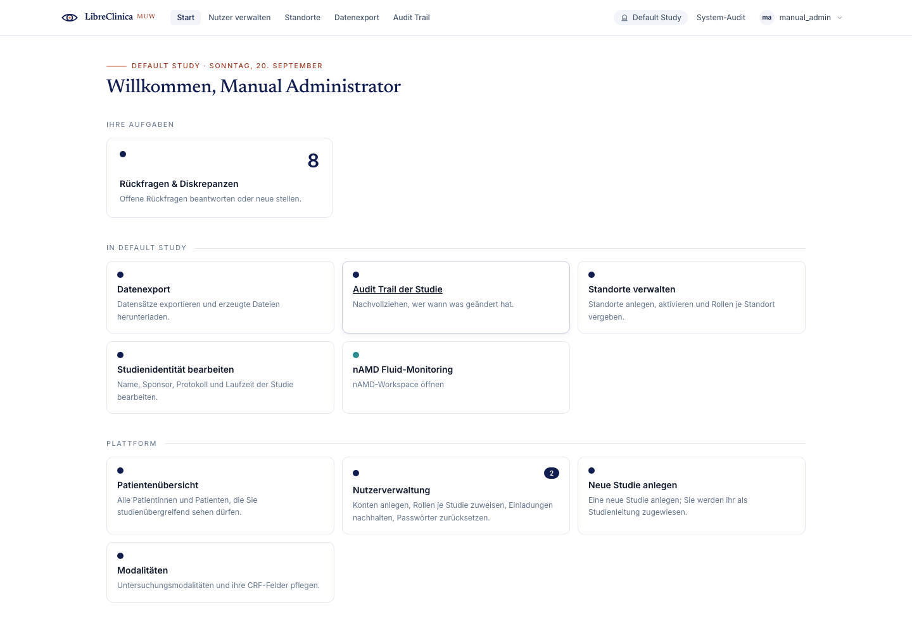

## 1. Subject Matrix

**Goal:** See every subject in the active study and their per-visit progress at a glance.

**Steps:**
1. Open **Studienteilnehmer** (Subject Matrix) from the home page or side-rail (`/subjects`).
2. Use the search box and the filter chips (*all*, *today*, *ready-to-sign*, *open-events*, *all-events-complete*, *signed*) to narrow the list; tick **Nur mit Queries** to show only subjects with open queries.
3. Read each row: the frozen left column is the **Subject ID**; scrollable columns show one status pill per visit, plus gender, study eye (OD/OS/OU), group and enrolment date.
4. Use the **V1 … VN** visit controls (First / Previous / Next / Latest) above the table to page across visits.
5. Click **Öffnen** (Open) at the right of a row to open that subject's detail page.

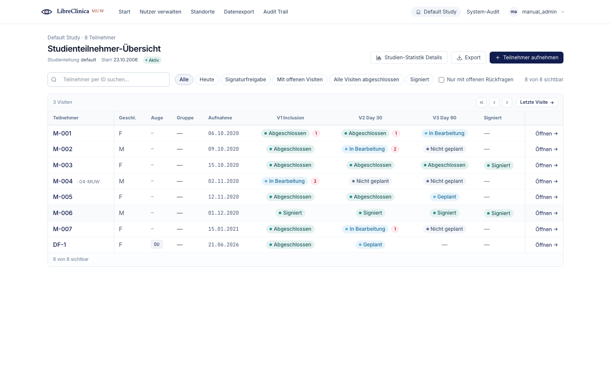

**Notes:** Open to Investigator, Monitor, Data Manager and Administrator. The **Export** button downloads the matrix; **Studienteilnehmer hinzufügen** (Add Subject) starts enrolment (see [role-investigator.md](role-investigator.md)).

## 2. Manage Users

**Goal:** Create, edit, disable/restore, unlock and password-reset user accounts, and assign per-study roles.

**Steps:**
1. Open **Nutzerverwaltung** (Manage Users) from the home page or side-rail (`/manage-users`).
2. To add a user, click **Nutzer/-in einladen** (Invite User) and complete the invite dialog; on success a one-time password is shown in an inline panel — copy it and hand it over through a secure channel.
3. Filter the table with the search box, the **Rolle** (role) and **Auth** dropdowns, and the **Nur aktive** (only active) checkbox.
4. For any row, use the inline actions: **Bearbeiten** (Edit) opens the edit dialog; **Deaktivieren** (Disable) / **Reaktivieren** (Restore) toggle the account; **Passwort zurücksetzen** (Reset Password) and **Entsperren** (Unlock) are offered only for active *Lokal* (local) accounts; **Rollen** (Roles) opens the role-assignment dialog.
5. After a restore, reset or unlock, the generated one-time password appears in the green panel below the table — copy it before dismissing.

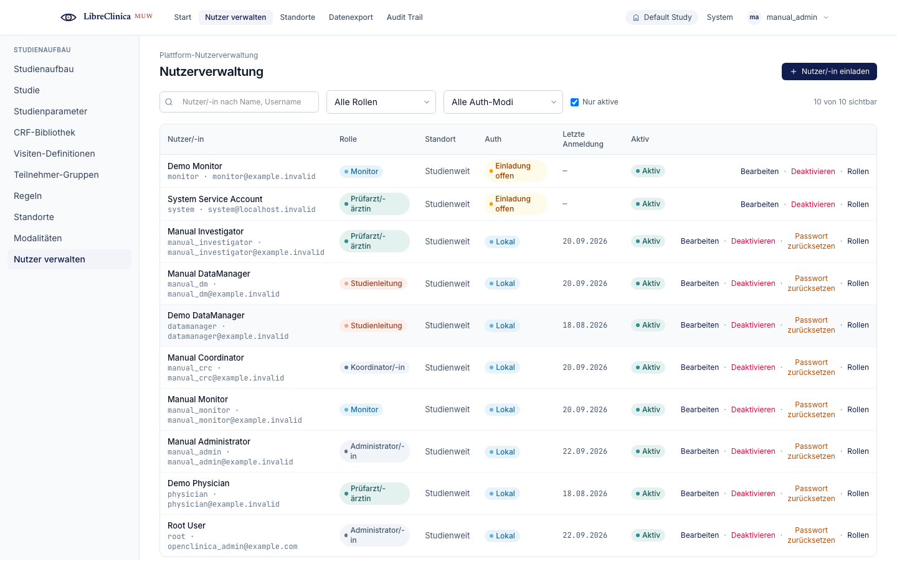

**Notes:** This screen is **Administrator-only** — the *Nutzer/-in einladen* button and every per-row action are hidden for other roles. Roles are shown with their German labels: *Prüfarzt/-ärztin* (Investigator), *Monitor*, *Studienleitung* (Data Manager), *Administrator/-in*, *Koordinator/-in* (CRC). The **Auth** column distinguishes *Lokal*, *SSO*, *LDAP (Legacy)* and *Einladung offen* (pending invite); password reset and unlock are unavailable for SSO/LDAP accounts because the identity provider or directory owns the credential. A locked local account also shows a warning badge in the **Aktiv** column. Every disable, restore, reset and unlock is documented in the audit trail (the confirmation dialogs say so), and via the multi-role dialog one user can hold several roles per study.

## 3. Sites (Prüfzentren)

**Goal:** Create and manage the sites of the active study.

A **site** (German *Prüfzentrum*) is a study's presence at one place: it belongs to exactly one study and is at exactly one **location** (German *Standort*, see [§19](#19-standorte-und-uploader-tokens-locations-and-uploader-tokens)). Roles, subjects and visits are kept apart per site.

**Steps:**
1. Open **Prüfzentren** (Sites) from the home page or the **Studienaufbau** rail (`/sites`). The list shows each site's location.
2. Click **Neues Prüfzentrum** (New Site) to open the inline create form.
3. Fill the required fields — *Name*, *Unique Protocol ID*, *Principal Investigator* — and choose the **Standort** (location) the site is at. The facility name and address (city, postcode, country) are taken from the location; the brief summary and the facility contact e-mail you enter yourself. Then click the create button.
4. For an existing site, use **Entfernen** (Disable) to soft-remove it or **Wiederherstellen** (Restore) to bring it back.
5. Only on an installation with several locations: **Standort ändern** (Change location) on a row moves a site to another location. The facility address is taken from the new location again, and the move is recorded in the audit trail.

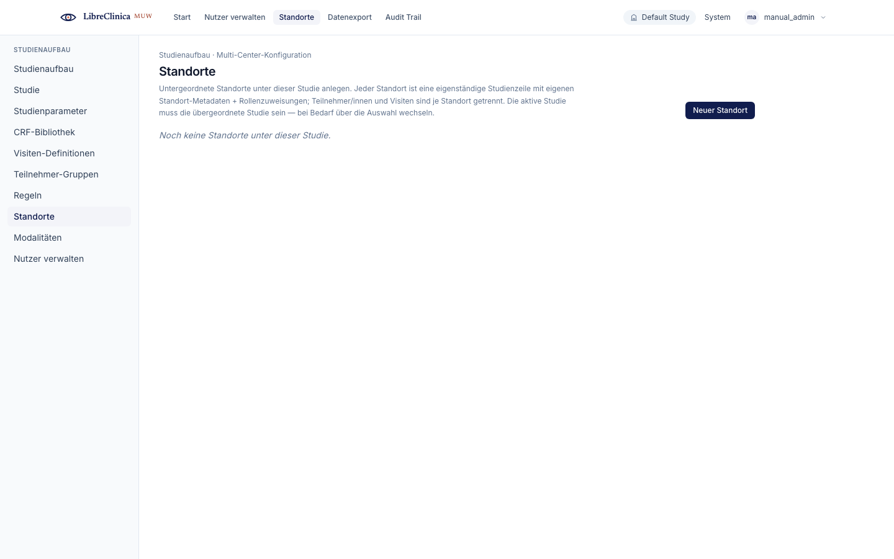

**Notes:** The active study must be the top-level parent — the screen is hidden when the active study is itself a site. Managing sites is open to Administrator and Data Manager. On a single-location installation (the default) the form has its one location already chosen and there is no *Standort ändern*. Disabling a site keeps its already-enrolled subjects and visits in the audit trail but makes them unreachable until the site is restored; the confirmation dialog states this.

## 4. Build Study

**Goal:** Track the study-setup checklist and drive each setup task to completion.

**Steps:**
1. Open **Studienaufbau** (Build Study) from the home page or side-rail (`/build-study`).
2. Read the progress card (tasks completed, percentage, site and enrolled-subject counts).
3. Work through the task tiles — *Create Study*, *CRF Library*, *Event Definitions*, *Sites*, *Group Classes*, *Rules*, *Manage Users* — each shows a status pill (complete / in-progress / not-started / optional). Click **→ Weiter** (Next) on a tile to jump to that task's screen.
4. For optional zero-count tasks, click **Als abgeschlossen markieren** (Mark as complete) to acknowledge them.
5. As Administrator, use the toolbar to change study status: pick a target state and confirm in the **Status wechseln zu …** (Change status to …) dialog, supplying a reason when transitioning to LOCKED or FROZEN. **Bearbeiten** (Edit) and **Parameter** open the study-identity and parameters editors; **Neue Studie** (New Study) starts study creation.

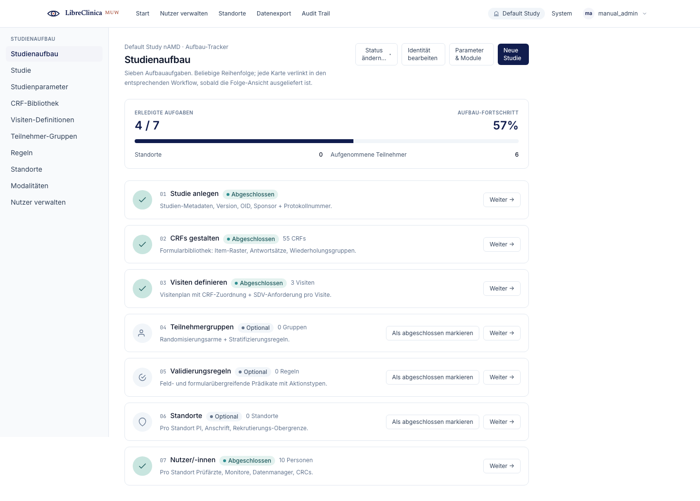

**Notes:** Build Study is open to Administrator and Data Manager, but the status dropdown, the status-change action and the *Neue Studie* button are Administrator-only. A reason is mandatory for the LOCKED and FROZEN transitions and is recorded in the audit trail.

## 5. Event Definitions

**Goal:** Define the visits (events) that make up the study schedule.

**Steps:**
1. From **Studienaufbau**, open the **Event Definitions** task, or go to `/event-definitions`.
2. Review the list of **Visiten-Definitionen** (Event Definitions).
3. Add or edit a definition, setting its name, type (e.g. scheduled vs. repeating) and the CRFs attached to it.
4. Order the definitions to match the clinical visit sequence.

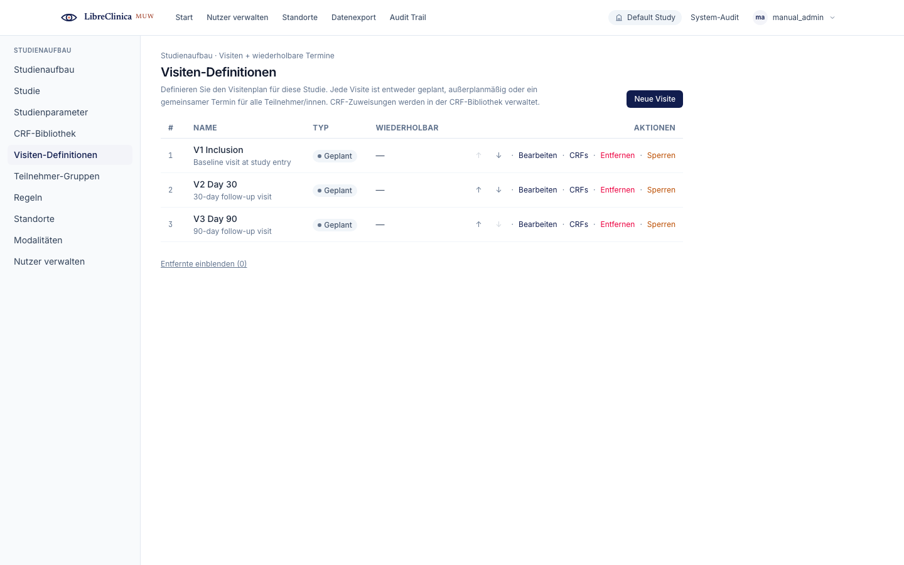

**Notes:** Open to Administrator and Data Manager. Event definitions are the backbone of the Subject Matrix columns, so changes here are reflected in every subject's visit list.

## 6. CRF Library (and CRF Builder)

**Goal:** Create case report forms, author new versions, and manage version lifecycle.

**Steps:**
1. Open **CRF-Bibliothek** (CRF Library) from Build Study or `/crf-library`.
2. Tick **Entfernte einschließen** (Include removed) to see soft-deleted CRFs.
3. Click **Neue CRF** (New CRF) and enter a name and optional description to create the form shell.
4. On a CRF card, click **Neue Version anlegen** (Create new version) to open the drag-and-drop **CRF Builder** canvas (`/crf-authoring-canvas/<oid>`), where you place sections and items, set data types and labels, then save the version.
5. Use the version sub-list to **XLS herunterladen** (Download XLS), and (as a managed user) Lock / Unlock / Restore / **Entfernen** (Disable) a version. *Hard Remove* is available only to system administrators and is blocked while any event definition or event CRF still references the version.

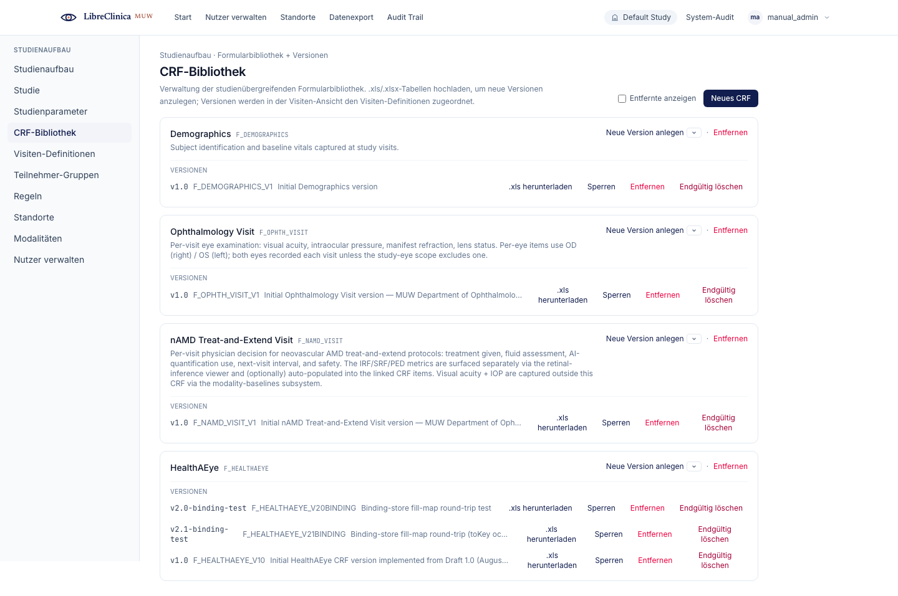

**Notes:** Open to Administrator and Data Manager. The drag-and-drop canvas is the sole CRF-authoring surface; the legacy side-rail wizard has been removed. A version that is in use cannot be hard-removed — the blocker dialog lists the event definitions and sample subjects holding it.

## 7. Rules

**Goal:** Inspect, author, test and schedule the study's edit-check and automation rules.

**Steps:**
1. Open **Regeln** (Rules) from Build Study or `/rules`.
2. In the left pane, search and select a rule set; its target, attached rules and run schedule appear on the right.
3. Click **Neue Regel** (New Rule) to open the rule wizard, or **Regeln importieren** (Import Rules) to load rules from XML.
4. For a selected rule set, edit the run schedule (tick *Schedule ausführen* and set a time), edit individual action messages, and run **Trockentest ausführen** (Dry run) to preview which subjects the rules would fire on.
5. Use **XML exportieren** (Export XML) to download all rules, and the **Test** sandbox at the bottom to evaluate an expression against sample values.

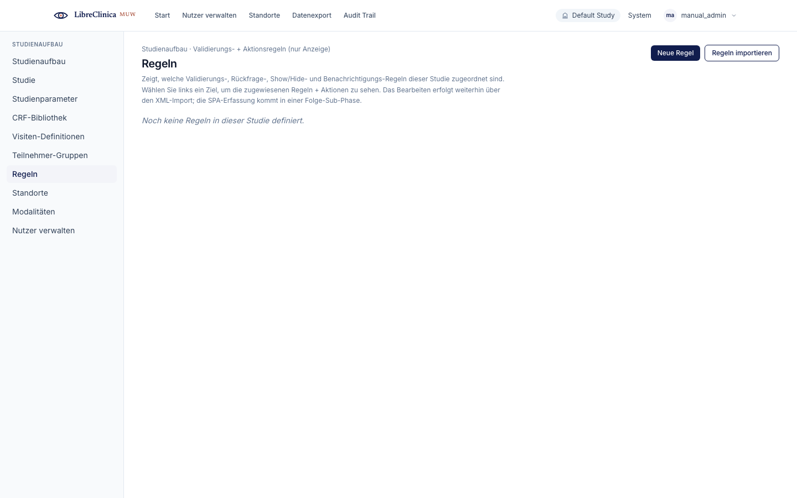

**Notes:** Open to Administrator and Data Manager; for other roles the screen is read-only. Rule actions include discrepancy notes, e-mail, notifications, show/hide, insert and randomize. The run log records each fired action with a timestamp.

## 8. Group Classes

**Goal:** Define subject groupings (arms, cohorts, families) for the study.

**Steps:**
1. Open **Teilnehmer-Gruppen** (Group Classes) from Build Study or `/group-classes`.
2. Add a group class, naming it and choosing its type.
3. Define the group values that subjects can be assigned to.

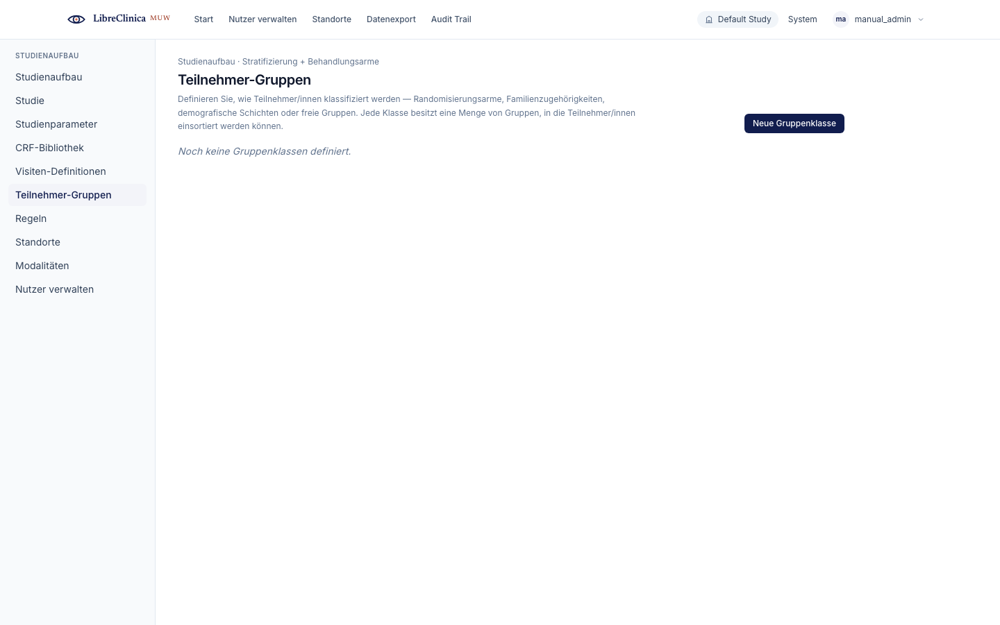

**Notes:** Open to Administrator and Data Manager. Group assignment then appears on each subject's detail page and as a column in the Subject Matrix. This is an optional setup task — it can be acknowledged as complete from Build Study even with zero groups.

## 9. Modalitäten

**Goal:** Maintain the platform-wide catalog of measurement modalities and their per-eye item bindings.

**Steps:**
1. Open **Modalitäten** (Modalities) from the home page (`/modalities`).
2. Click **Neue Modalität** (New Modality) to register one. Supply the stable **code** (fixed after creation), the German and English labels, the ordinal (its rank in picker dropdowns), the data type (numeric / categorical), an optional unit (mm, mmHg, …), and the OD and/or OS item OID(s) — at least one is required.
3. Use **Bearbeiten** (Edit) to change a modality, or **Entfernen** (Delete) to retire it.

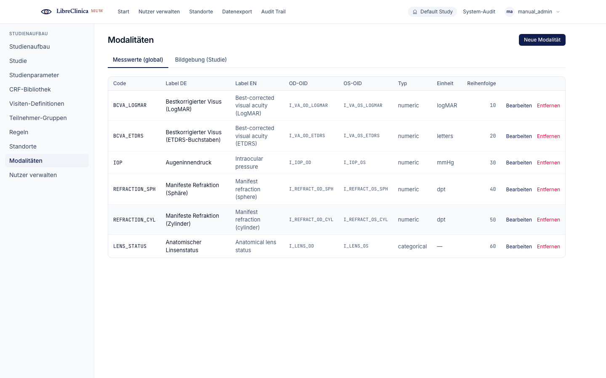

**Notes:** This is an **Administrator-only**, platform-wide catalog (not study-scoped). The table columns are *Code*, the German and English labels, the OD and OS item OIDs, type, unit and ordinal. Removing a modality keeps existing baseline measurements but drops the modality from the per-eye baseline panel; the confirmation dialog states this.

## 10. Datasets / Data Export

**Goal:** Build reusable export datasets and download study data in your chosen format.

**Steps:**
1. Open **Datenexport** (Data Export) from the home page or side-rail (`/datasets`).
2. For a quick dump, click **Schnell-ODM-Export** (Quick ODM export). For a tailored extract, click **Neuer Datensatz** (New Dataset) and complete the dataset wizard.
3. In the dataset table, expand **View files** to see generated files, **Open wizard** to edit a dataset (disabled once it has been run), or **Remove** / **Restore** to manage its lifecycle.
4. Click **Export now** and pick a format — *odm*, *csv*, *tsv*, *excel*, *sas* or *spss* — then download the generated file.
5. Click **Schedules** to set up recurring exports of the dataset. **Add schedule** takes a format, a time (a Quartz cron expression, with presets for daily, weekly and monthly runs) and an optional contact e-mail, which is mailed when a run finishes or fails. A schedule can be edited, paused, resumed or deleted, and a change applies at once.
6. An export running in the background (the bundle, or a scheduled run) shows its progress under its dataset. **Cancel export** stops it: a waiting export does not run, and a running one stops at its next checkpoint and leaves no file.

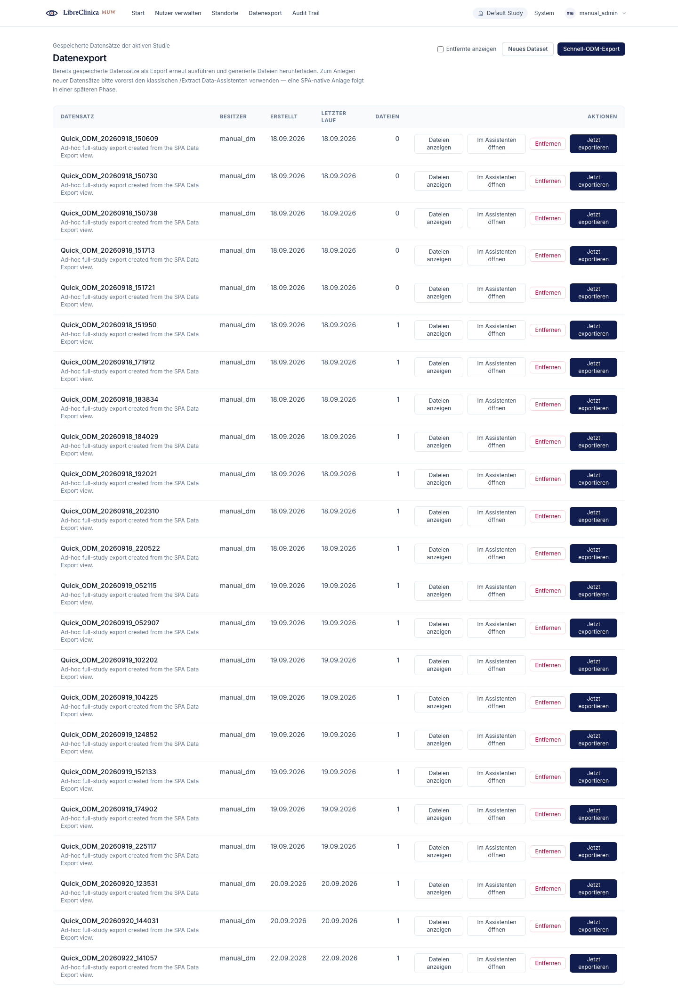

**Notes:** Open to Administrator, Data Manager and Monitor. Tick **Entfernte einschließen** (Include removed) to show soft-deleted datasets. A dataset that has already run cannot be edited — clone or create a new one instead. Schedules replace the legacy *Create Scheduled Job: Export Dataset* screen; a schedule's exports run as the user who created it.

## 11. Import CRF Data

**Goal:** Bulk-load CRF data from an ODM XML file through a guided, four-step wizard.

**Steps:**
1. Open **CRF-Daten importieren** (Import CRF Data) from the home page or side-rail (`/import-crf-data`).
2. **Hochladen** (Upload): drag an `.xml` file onto the drop zone (or browse), then click **Weiter** (Next).
3. **Mappen** (Map): check the detected counts of subjects, events, CRFs and rows, then continue.
4. **Vorschau & Auflösung** (Preview & Resolve): review the status cards (*Ready*, *Overwrite*, *Warning*, *Error*) and the per-row table. Resolve issues, choose an overwrite mode (replace or skip), and — if any rows will be replaced — type a **Reason for change** before continuing.
5. **Commit**: the system applies the import and shows a summary (rows inserted, overwritten, skipped, discrepancy notes). Use **Start over** to import another file.

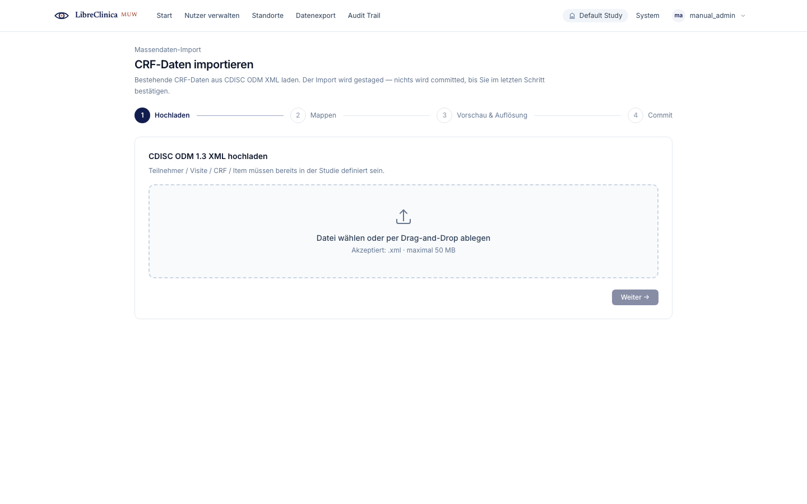

**Notes:** Open to Administrator and Data Manager. The commit step is entered by the system, not clicked. You cannot commit while any row is in error; overwriting existing data in *replace* mode requires a reason, which is recorded in the audit trail. If the upload token expires before commit, re-upload the file.

## 12. System Audit Log

**Goal:** Review the institution-wide audit trail, including operation failures and failed jobs.

**Steps:**
1. Open **System-Audit-Protokoll** (System Audit Log) from the **System** rail (`/system/audit-log`).
2. Filter by actor, event variant (signed, reason-for-change, sdv, admin, data, query, subject-group-change) or subject.
3. Browse the date-grouped timeline; click an entry with a chevron to expand its before/after diff and reason.

**Notes:** This system-wide log is **Administrator-only** and surfaces rows the per-study *Audit Trail der Studie* hides — notably `OPERATION_FAILED` and `JOB_FAILED` entries. It has no study scope and (unlike the per-study audit view) no XLSX export.

## 13. System Status

**Goal:** Check the health of the running application after a restart or incident.

**Steps:**
1. Open **Systemstatus** (System Status) via **System** in the top bar (`/admin/system-status`) — it is the section's landing page.
2. Read the three panels: **JVM** (Java version, heap used/max, threads, CPUs), **Database** (reachability, product/version, Liquibase changelog count), and **Application** (status OK/OutOfMemory, uptime).
3. Below them, the **retinal-inference cluster**: one row per GPU node with its state, the analysis tasks it offers, its GPU and its response time, and the last alerts of the cluster monitor.
4. **Uploader an den Aufnahme-PCs** (uploaders on the acquisition PCs): one row per upload program (the Export Watcher on the Clarus and Spectralis PCs, the Optomed Bridge beside the Optomed Client) with its state, when it last reported, the files it holds and the ones it gave up on, and the free space on the PC's disk. The states are *In Ordnung* (fine), *Braucht Aufmerksamkeit* (a problem is listed under it, e.g. `upload-failed`, `no-subject-folder` for an `.E2E` lying outside a patient folder, `file-too-large`), *Ausgeschaltet* (running, uploading switched off), *Beendet* (closed from its menu, red) or *Abgemeldet oder heruntergefahren* (the PC was shut down, grey), and *Keine Meldung* (silent for three reporting intervals: crashed, or the PC lost the network). **Entfernen** (Remove) forgets a program whose PC was replaced; a program that still runs comes back with its next report.
5. Under it, **Eingänge je Gerät** (arrivals per device): what arrived from each device and by which way in, over the last 90 days. A healthy uploader with no arrivals usually means the export goes into another folder.
6. **Speicherplatz** (storage): how full each disk is, each file store's size and file count with the change over seven days, the database's size, and — when free space shrank over the last week — roughly how many days remain. The figures are measured once an hour; **Jetzt messen** (measure now) measures immediately.
7. Click **Aktualisieren** (Refresh) to re-poll all panels; the last-refreshed time is shown next to the button.

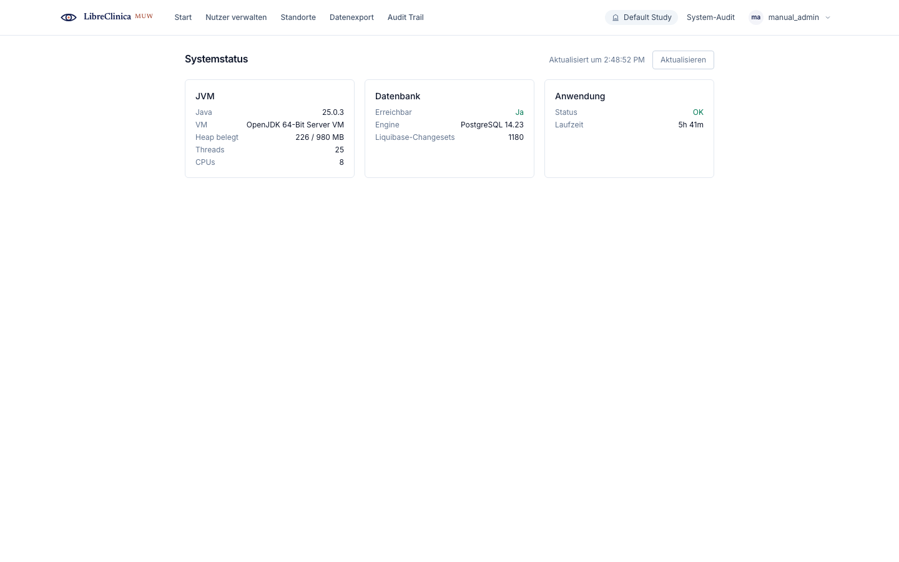

**Notes:** Administrator-only; the backend returns 403 for any other session. Apart from removing an uploader and starting a measurement, this is a read-only diagnostics view. The uploaders' reports carry counts, ages, disk figures and coded problems only — nothing about a patient.

## 14. Password Policy

**Goal:** Set the password rules enforced for local accounts.

**Steps:**
1. Open **Passwort-Richtlinie** (Password Policy) from the **System** rail (`/admin/password-policy`).
2. Tick the required character classes (lowercase, uppercase, digits, special characters).
3. Set the length constraints — *Min Length*, *Max Length* (1–256) — and *Expiration Days* (0 = no expiration).
4. Optionally require a password change on first login, then click **Save** (or **Discard** to revert to the last-saved values).

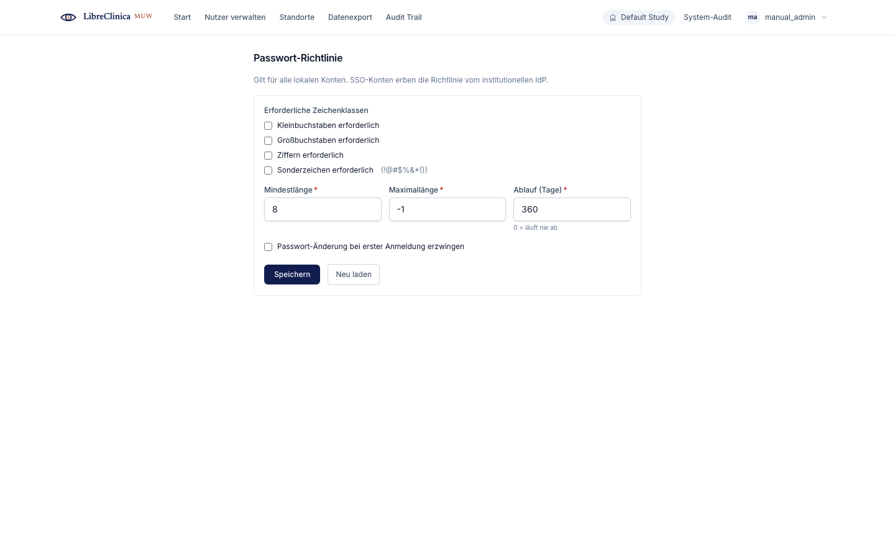

**Notes:** Administrator-only. On success a *Gespeichert* (Saved) banner appears. The policy applies to local accounts; SSO/LDAP credentials are governed by the identity provider or directory.

## 15. App Configuration

**Goal:** See what configuration the running application actually reads.

**Steps:**
1. Open **Anwendungskonfiguration** (App Configuration) from the **System** rail (`/admin/config`).
2. Read the values: default timezone, user language/country, file encoding, OS name/architecture, JVM options, the retinal-inference remote-push URL, and whether SSO is enabled.
3. Click **Aktualisieren** (Refresh) to re-read after a restart.

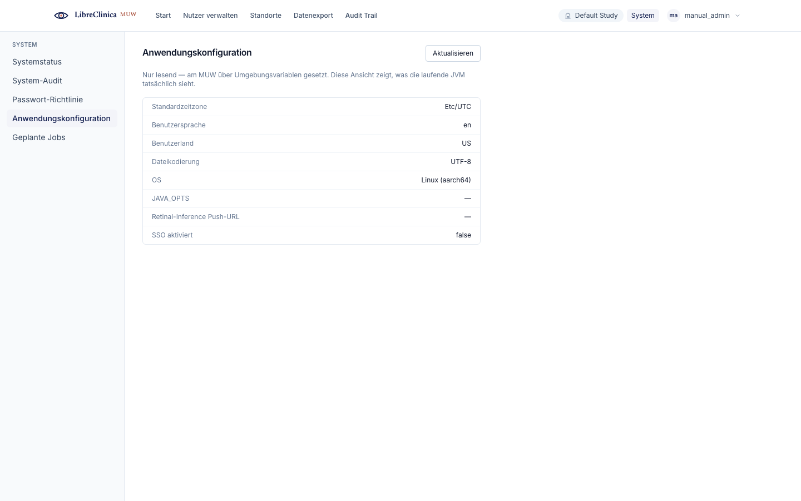

**Notes:** Administrator-only and **read-only** — deployment configuration lives in environment variables, not here. This screen simply surfaces what the running JVM sees, which is useful for diagnostics after a restart.

## 16. Scheduled Jobs

**Goal:** Inspect the background (Quartz) jobs the platform runs.

**Steps:**
1. Open **Geplante Jobs** (Scheduled Jobs) from the **System** rail (`/admin/jobs`).
2. Review the scheduler status bar (name, started/standby) and the jobs table: name, group, state, previous and next fire times, description.
3. Click **Aktualisieren** (Refresh) to re-poll.
4. A scheduled export made with the legacy *Create Scheduled Job* screen (group *XsltTriggersExportJobs*) carries a **Legacy export** badge with its dataset, period, format and contact e-mail. It keeps running until it is deleted. Recreate it as a schedule of the dataset (**Datenexport** → **Schedules**), then click **Delete** here.

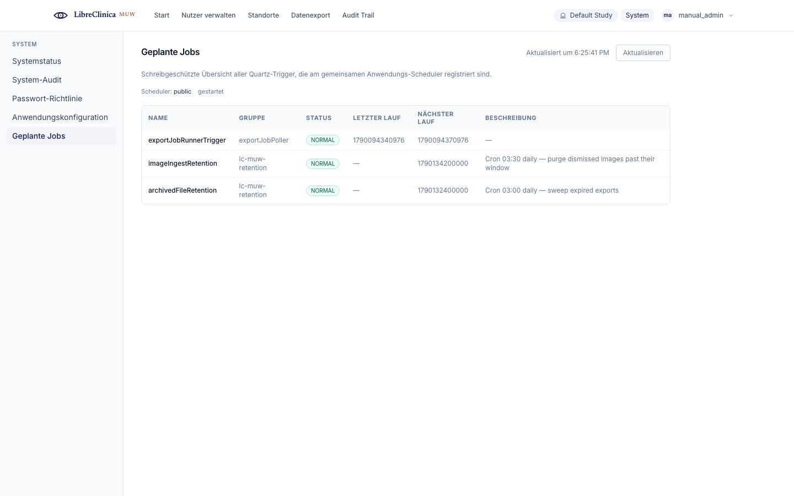

**Notes:** Administrator-only. Only legacy scheduled exports can be deleted here; every other trigger belongs to the platform and is read-only. New export schedules are set up per dataset under **Datenexport**. The state pill is colour-coded (NORMAL green, PAUSED amber, ERROR/BLOCKED red). An empty list shows *Keine Jobs* (No jobs).

## 17. Subject Detail, Study Identity and Parameters

**Goal:** Inspect a single subject, and edit the active study's identity and parameters.

**Steps:**
1. From the Subject Matrix, click **Öffnen** on a row to open the subject detail page (`/subjects/<id>`).
2. Review the **IDENTITÄT** (Identity) block (Subject ID, secondary ID, gender, year of birth, group, study eye OD/OS, enrolment/screening dates, open-query count, signed status) and the **BESUCHE** (Visits) table. Use **Bearbeiten** (Edit) to amend identity fields, **CRFs öffnen** (Open CRFs) to enter data, and the row kebab menu (⋮) for *Stornieren* (Cancel) or *Signieren* (Sign).
3. To create a study, open **Neue Studie** from Build Study or go to `/studies/new` and complete the create form.
4. To change a study's identity, open **Bearbeiten** from Build Study (`/studies/<oid>/edit`) — the **Studien-Identität bearbeiten** form covers name, secondary protocol ID, phase, brief summary, principal investigator, sponsor, official title and protocol type. Click **Save**.
5. To change behaviour, open **Parameter** (`/studies/<oid>/parameters`) — the **Studienparameter** form groups subject-ID generation, discrepancy management, interviewer/interview-date defaults and module toggles. Click **Save**.

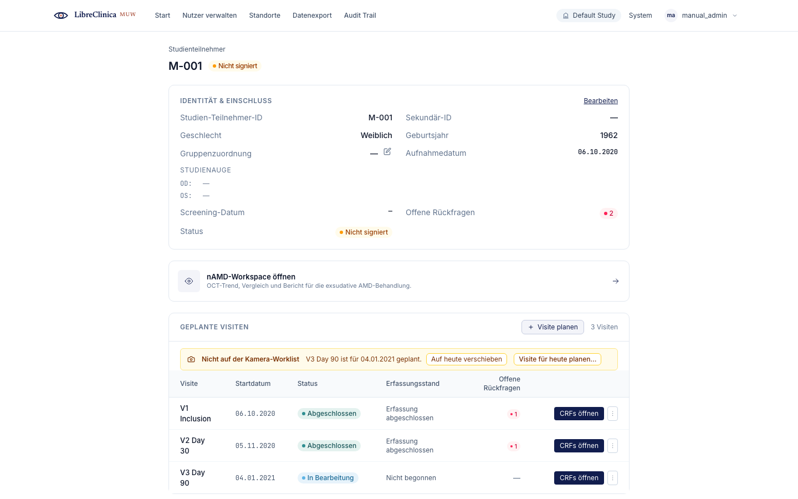

**Notes:** Subject detail is open to Investigator and Administrator. Study creation, identity edit and parameters edit are **Administrator-only** and re-checked on the backend (403 on denial). Saving the study identity refreshes the breadcrumb if the edited study is the active one. Subject identity edits, eye transitions, event cancellations and signatures are all recorded in the audit trail.

## 18. Eingang (all inbound files)

**Goal:** Review files that arrived from a camera, the upload page or a C-STORE and still need a visit, and file or dismiss them.

**Steps:**
1. Open **Eingang** (`/ingest-inbox`) — the cross-study queue of every inbound file: OCT scans, DICOM images, fundus photos.
2. Filter by kind with the chips (**OCT-Scan**, **DICOM-Bild**, **Fundusbild**, **Andere Datei**), by status, or by a label/filename fragment. Each card shows the preview, the patient-ID hint, the eye, the acquisition date and where the file came from.
3. **Zuordnen …** files one card (or a selection) against a subject's visit; **Verwerfen** marks a file as not study data with a reason. **Hochladen** opens the staff uploader for bringing files in yourself.

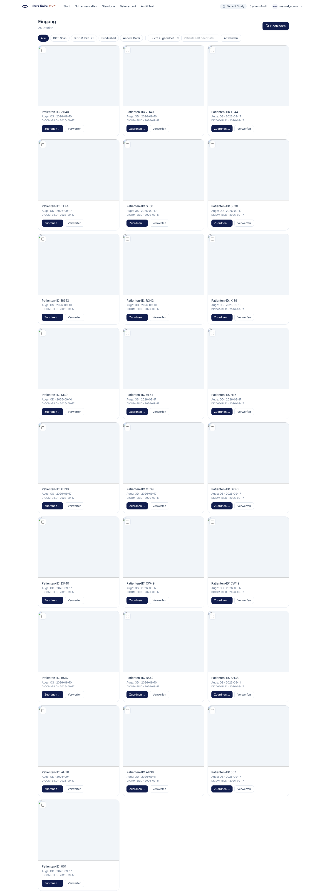

**Notes:** Data Manager, Investigator and Administrator may reconcile. Binding a file ticks the visit's "performed" checklist item; unbinding takes the tick back. Dismissed files are deleted by the retention sweep after 30 days.

## 19. Standorte und Uploader-Tokens (locations and uploader tokens)

**Goal:** Keep the platform's locations, decide who sees each location's device files, and give every acquisition PC its own token.

A **Standort** (location) is a physical place: a clinic, a department or a partner hospital. Locations are platform-wide; a study is active at a location by having a **Prüfzentrum** (site) there. Files from devices belong to the location of their source and appear in the **Eingang** (§18) only for people who belong to that location — through a role at one of its sites, or through an explicit assignment.

**Steps — locations:**
1. Open **System** → **Standorte** (Locations, `/admin/locations`). The list shows each location's code, name, place, its counts of sites, studies, files and people, and its status. **Bearbeiten** (Edit) changes the name and address (the code is fixed); **Deaktivieren** (Disable) works only when no study and no site at the location is still active.
2. Click a location's name to open its details. Under **Zugewiesene Personen** (assigned people), **Person hinzufügen** (Add a person) → username → **Zuweisen** (Assign) gives staff without a study role, such as a photographer, sight of the location's device files.
3. Tick **Standort-Admin** for an assigned person to let them issue, replace and revoke this location's uploader tokens. A study role does not include this right; grant it deliberately (typically to the local IT contact or study coordinator).
4. The **Quellen** (Sources) tab lists where device files come from: uploaders, DICOM devices (by AE title) and the Remidio account. Choose a location for a source that has none; its waiting files move into that location's inbox at once.

**Steps — uploader tokens:**
1. Open **Uploader und Tokens** (Uploaders and tokens, `/uploaders`) from **System** or the home-page card. Click **Uploader anlegen** (Create uploader) and give the PC a recognisable name, unique per location (e.g. "Clarus-PC Raum 3").
2. The token (`mwu_…`) is shown **once**. Copy it, tick **Ich habe den Token gesichert** (I have saved the token), and close the dialog. The platform keeps only a hash and the first characters (*Token (Anfang)*), so a lost token is replaced, never looked up.
3. On the acquisition PC: the Export Watcher's or Optomed Bridge's tray icon → *Settings...* → **Uploader-Token** → paste → save. Never on a command line.
4. After a few minutes, **Aktualisieren** (Refresh) shows **Zuletzt verwendet** (last used) and **Letzte Meldung** (last report) for the row.
5. The dialog also offers a **Link für die Upload-Seite** (`…/upload#token=…`) for the browser upload page: whoever opens the page through it uploads for that location. The link is the token in another form; hand it only to people who upload at that location.
6. **Token ersetzen** (Replace token) issues a new token and stops the old one at once — do it when a PC is replaced or a token may have been seen by the wrong person. **Sperren** (Revoke) refuses the token for good, for example when a PC is retired; replacing the token lifts a revocation.

**Notes:**
- **One location or several is a deployment setting**, not something this page changes. By default an installation runs with **one** location: *Standort anlegen* (Create location) is not offered, everything belongs to the one location, and uploaders keep working without a token. A second location needs IT to set `LIBRECLINICA_DEPLOYMENT_LOCATIONS=multi` and restart, after every acquisition PC has its token; until then *Uploader und Tokens* shows administrators how many programs still send without one, which must read 0 before the switch. See [deploy/README.md, "Uploader tokens and locations"](../../../deploy/README.md#uploader-tokens-and-locations-dr-040).
- **When an uploader answers 401.** *Token fehlt* (401 `uploader token required`) means a multi-location installation and a PC without a token; *Token abgelehnt* (401 `uploader token rejected`) means the token is unknown, replaced or revoked, or its location is disabled. Either way every file stays on the PC and goes through by itself once the token is right. Because its heartbeat is refused too, such a PC may look silent on **Systemstatus**; its tray icon says why.
- **Spectralis exports: one folder per patient (Export Watcher).** The watcher on the Spectralis PC takes the subject label from the **folder name**: the folder that directly contains the file, at any depth below its watch folder (both `<watch folder>\EIAMD005\EIAMD01D.E2E` and `<watch folder>\Export\EIAMD005\EIAMD01D.E2E` are uploaded as subject EIAMD005). The `.E2E` header is not read. Each file is uploaded once, up to 2 GiB, and the platform splits it into one item per series and eye (OCT volume, OCT line scan, IR, autofluorescence, angiography); these appear in the **Eingang** (§18) with their modality and frame count. When the header carries a patient ID that differs from the folder name, every series of that file is parked in the **Eingang** for a person to decide. A file the platform already has (same content) is recognised before it is sent and simply filed away. An `.E2E` lying **directly in the watch folder** has no subject: it is not uploaded, and **Systemstatus** (§13) lists the problem `no-subject-folder` for that PC until the file is moved into a patient folder. A file over 2 GiB is moved to `_failed` unsent (`file-too-large`). Files are filed into an `_uploaded` / `_failed` folder inside each patient folder on the PC. Details: [deploy/README.md, "Clarus and Spectralis exports"](../../../deploy/README.md).
- *Standorte* is Administrator-only. *Uploader und Tokens* is open to Administrators (every location) and to Standort-Admins (their own location only), whatever their study role. Every change on both pages is recorded in the system audit log; a token never is.
